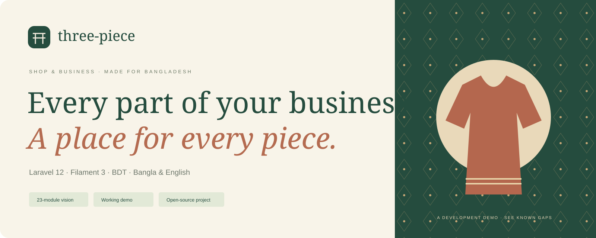
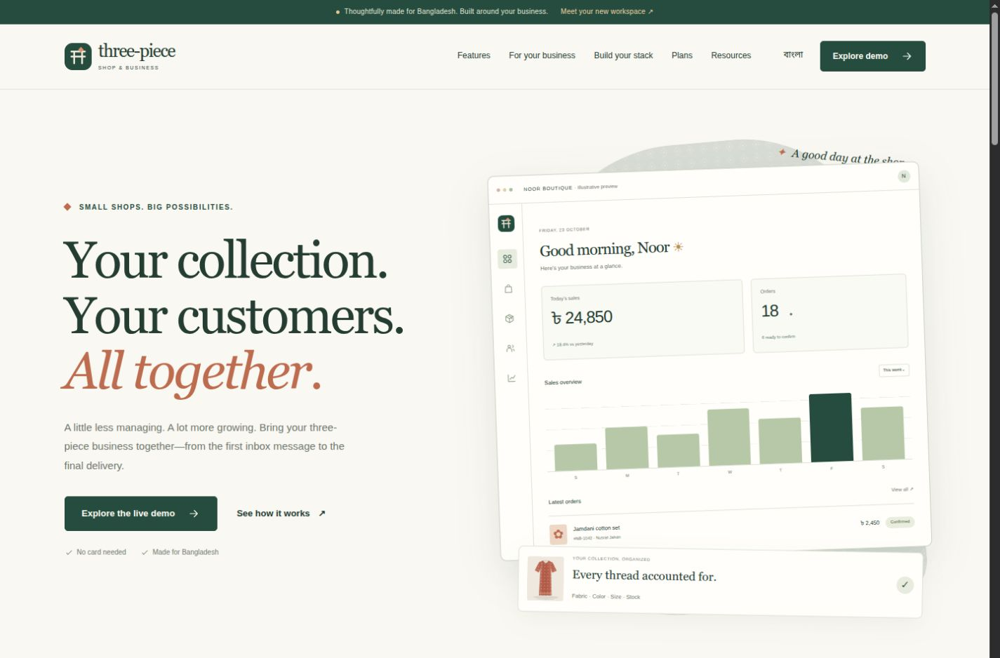
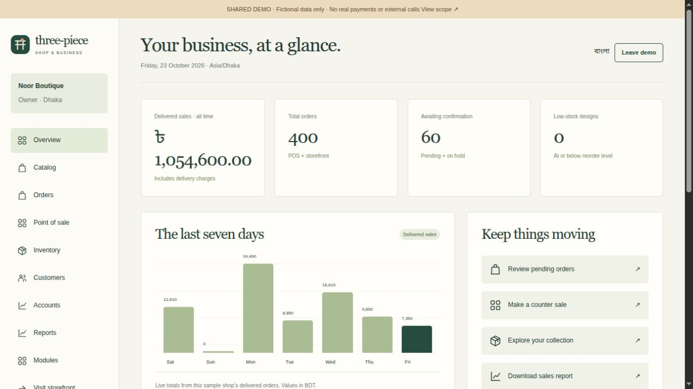
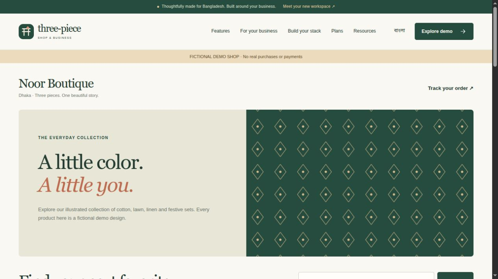
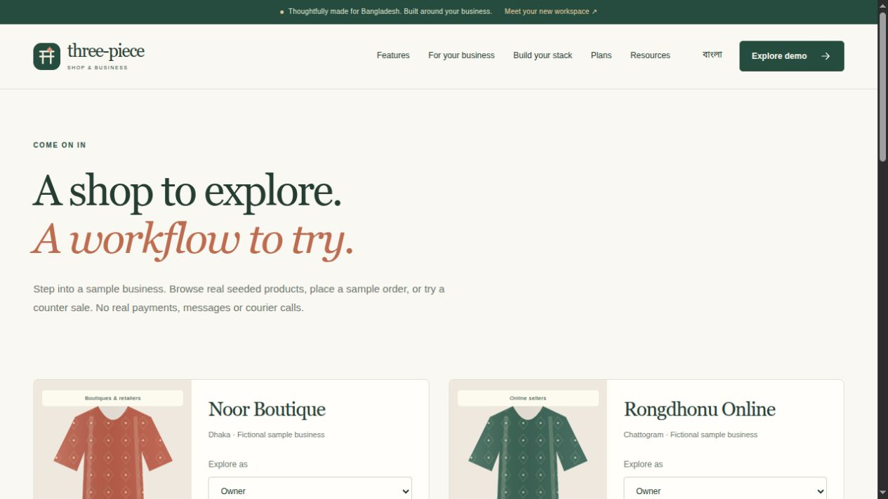
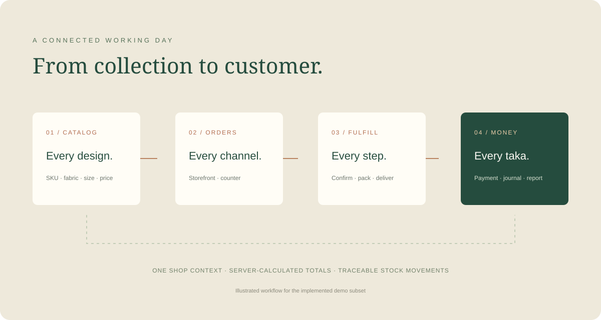

# Three-Piece Shop / থ্রি-পিস শপ

A modular business-software project for Bangladeshi women's three-piece sellers: online shops, boutiques, wholesalers, importers and tailoring businesses.

**Current release:** a complete public website and a working, tenant-scoped demo of core retail workflows. This is a development demo, not the completed production ERP described in the [master specification](docs/MASTER-PROMPT.md). The registry describes 23 modules; advanced scope is clearly marked as roadmap or partial. See [KNOWN-GAPS](docs/KNOWN-GAPS.md) before using real business data.



## What you can do today

- Explore a responsive public website in **English and Bangla**, with self-hosted Bengali font, textile graphics, accessible navigation, mobile layouts and reduced-motion support.
- Browse **23 module detail pages**, five business presets, illustrative plans, workflow comparisons, practical guides, FAQs, privacy/terms, changelog and repository-backed docs.
- Build a module stack: automatic dependency inclusion, locked essentials, browser-local persistence, preset selection and shareable links.
- Enter one of **four fictional shops** with six restricted demo roles. Noor Boutique has **60 products and 400 orders**; all shops together have **156 products and 640 orders over 90 days**.
- Search products by design/SKU, create a product variant, record fabric/form/color/size, price, cost and opening stock.
- Browse the sample storefront, search designs, place a guest COD order, view a private receipt and track an order using its number plus recipient phone.
- Process orders through pending → confirmed → packed → shipped → delivered; hold or cancel eligible orders.
- Confirm stock atomically, prevent overselling, restore committed stock on cancellation and record manual stock adjustments with reasons.
- Make a counter sale with a server-validated **cash + bKash split**, transactional stock updates and a printable receipt and a scoped Bangla PDF download.
- Record partial cash/MFS/bank collections on delivered orders, reject overpayments and deduplicate retries.
- Review balanced sales/payment journal entries, receivables, gross margin, a seven-day sales chart and scoped CSV exports.
- Toggle optional modules without deleting tenant data; block disabled screens and unauthorized role actions.
- Save contact/plan-interest messages with validation, rate limits, CSRF and a honeypot. No automatic outbound message is sent.





[Feature index screenshot](docs/images/features.png) · [Module planner screenshot](docs/images/module-planner.png) · [Bangla mobile screenshot](docs/images/mobile-bangla.png)

## Public pages

| Route | Content |
| --- | --- |
| `/` | Product introduction, illustrated workspace, business types, workflows and FAQ |
| `/features` | Searchable/filterable index generated from the module registry |
| `/features/{module}` | Scope, dependencies and honest implementation status for each module |
| `/solutions`, `/solutions/{preset}` | Five business types and recommended stacks |
| `/modules` | Interactive module planner with local storage and shareable selection |
| `/pricing` | Clearly labelled illustrative plans; interest form instead of billing |
| `/demo` | Four sample shops and six role choices; session-based one-click demo sign-in |
| `/how-it-works`, `/compare` | Workflow diagram and implemented-workflow comparison |
| `/docs`, `/docs/{page}` | Allowlisted repository Markdown, rendered without embedded HTML |
| `/blog`, `/blog/{article}` | Three original bilingual business guides |
| `/faq`, `/contact`, `/changelog`, `/privacy`, `/terms`, `/status` | Complete supporting pages and persisted contact form |
| `/sitemap.xml`, `/robots.txt`, `/llms.txt` | Public discovery, canonical URLs and module parity |
| `/s/{shop}`, `/s/{shop}/product/{slug}`, `/s/{shop}/track` | Sample storefront, product checkout and private order lookup |

Pages include canonical/OpenGraph metadata; the site exposes SoftwareApplication and product JSON-LD. The homepage workspace illustration is explicitly an illustrative preview; dashboard screenshots below show the actual demo.

## Quick start

Use **PHP 8.3**, Composer 2, Node 22+, PDO SQLite for a quick local demo, or MySQL 8 + Redis for the target deployment. Required PHP extensions include mbstring, intl, curl, bcmath, sockets, zip and PDO; GD is needed for the future image-conversion pipeline. Composer's platform is pinned to PHP 8.3.0; Laravel remains pinned to 12.x and Filament to 3.x.

```bash
composer install
cp .env.example .env
php artisan key:generate
php -r "file_exists('database/database.sqlite') || touch('database/database.sqlite');"
php artisan migrate
php artisan demo:seed
npm ci
npm run build
php artisan serve
```

Open **http://localhost:8000** or **http://localhost:8000/demo**. Set `DEMO_MODE=true` in a non-production environment. Demo login and seeding are prohibited in production. `demo:seed` adds missing sample shops without resetting existing ones. Never run `migrate:fresh` against real data.

### Demo businesses and access

| Shop | Slug | Products | Orders |
| --- | --- | ---: | ---: |
| Noor Boutique / নূর বুটিক | `noor` | 60 | 400 |
| Rongdhonu Online / রংধনু অনলাইন | `rongdhonu` | 40 | 110 |
| Dhaka Fabrics Wholesale / ঢাকা ফ্যাব্রিকস হোলসেল | `dhaka-fabrics` | 32 | 80 |
| Sundori Tailors / সুন্দরী টেইলার্স | `sundori` | 24 | 50 |

Use the `/demo` role launcher. Seeded users follow **`{role}@{slug}.demo.test`**, password **`password`**. Roles: `owner`, `manager`, `cashier`, `agent`, `stock`, `accounts`. Examples: `owner@noor.demo.test`, `cashier@noor.demo.test`. These credentials are demo records; the implemented sign-in flow is the one-click launcher rather than a password-login screen.

Owners/managers can manage products and modules; cashiers can use POS; sales agents can confirm orders; stock keepers can adjust inventory; accountants can collect payments and review accounts/reports. A shop's preset can hide a screen even if a role is permitted to use it. The sandbox is shared—enter fictional information only.



## Module feature matrix

Generated by `php artisan docs:features` from `app/Modules/catalog.json`, the same registry used by public feature pages, presets and in-app module settings. **Partial** means only the explicitly documented demo subset works. **Planned** means business workflows are not implemented; feature descriptions are product scope, not shipped claims.

<!-- FEATURES:START -->
| Module | Features | Demo status |
| --- | --- | --- |
| `core` · Business essentials | Shop profile and branding; Staff roles and permissions; Branches and business settings; Media, imports and audit history | partial |
| `catalog` · Product catalog | Unstitched, ready-made and custom-stitch forms; Color and size variants with SKUs; Fabric, work, origin and occasion attributes; AI drafts, review and bilingual publishing | partial |
| `orders` · Order management | Unified order list and channel filters; Pending-to-delivered workflow; Customer details and order timeline; Invoices, notes and bulk actions | partial |
| `customers` · Customer directory | Phone-based customer profiles; Addresses and purchase history; Customer notes and groups; Measurements and preferences | partial |
| `inventory` · Inventory | Stock movements and on-hand balances; Multi-location transfers and stocktake; Low-stock alerts and reorder levels; Batches, fabric lengths and reservations | partial |
| `purchasing` · Purchasing | Suppliers and purchase orders; Goods receipts and purchase returns; Freight, customs and landed cost; Supplier balances and payments | planned |
| `pos` · Point of sale | Product search and touch-friendly cart; Cash, bKash and split payments; Cashier shifts and drawer reconciliation; Receipts, held carts and exchanges | partial |
| `storefront` · Online storefront | Responsive product and collection pages; Guest checkout with COD; Phone and order-number tracking; SEO, size advice and customer accounts | partial |
| `landing_pages` · Campaign pages | Campaign templates and block editing; One-page product order form; Delivery zones and UTM attribution; Incomplete-order capture and conversion reports | planned |
| `order_confirmation` · Pending order desk | Agent assignment and call notes; Confirm, hold or cancel with reasons; Duplicate and high-value COD flags; SLA reminders and agent performance | partial |
| `courier` · Courier & delivery | Shipment booking and tracking; Pathao, Steadfast, RedX, eCourier, Paperfly adapters; COD collection reconciliation; Delivery performance and return-to-origin | planned |
| `payments` · Payments | Cash, COD and manual MFS verification; Partial and advance payments; Refunds and payment ledger; Signed, idempotent gateway webhooks | partial |
| `returns` · Returns & exchanges | Return requests and reason tracking; QC, restock or write-off decisions; Exchanges with price differences; Cash, MFS or store-credit refunds | planned |
| `wholesale` · Wholesale | Wholesale tiers and minimum quantities; Approved buyer accounts and quotations; Credit limits and due ledgers; Carton orders and reseller price lists | planned |
| `production` · Tailoring & production | Customer measurement profiles; Bills of materials and fabric issue; Cutting, stitching, finishing and QC; Job cards and piece-rate wages | planned |
| `crm` · Customer relationships | Loyalty points and tiers; Store credit and customer dues; VIP and dormant customer segments; Follow-ups and occasion reminders | planned |
| `marketing` · Marketing | Coupons, flash sales and bundles; Segmented campaigns and recovery; Product feeds and conversion events; AI captions, scripts and campaign ROI | planned |
| `accounts` · Accounts | Cash, bank and MFS accounts; Double-entry journals and expenses; Profit and loss, balance sheet and cash flow; Trial balance, VAT and period closing | partial |
| `hr` · People & payroll | Employees, shifts, leave and holidays; Device, ADMS, GPS and QR attendance; Salary, advances and commissions; Payroll with overtime and piece-rate wages | planned |
| `reports` · Business reports | Sales by channel, fabric, size and district; Margins, valuation and stock aging; Delivery success and COD pending; CSV, Excel, PDF and scheduled summaries | partial |
| `insights` · Insights | Executive widget dashboard; Order Kanban and delivery calendar; Natural-language business questions; System health and tamper-evident audit | planned |
| `ai` · AI assistant | Conversation-to-order drafts; Bilingual copy and reply suggestions; Size, price and reorder advice; Visible per-shop monthly AI budgets | planned |
| `integrations` · Integrations | Scoped REST APIs and tokens; Signed webhooks with retry logs; CSV and Excel imports; Data export, backups and usage logs | planned |
<!-- FEATURES:END -->

See `/status` and [MODULES](docs/MODULES.md) for the exact working subset and remaining features.

## Architecture



- **Laravel 12 + Blade + Tailwind 4**, with light browser JavaScript for navigation, search, module selection and counter totals. Server-rendered public pages work without hydration.
- **Filament 3 is installed**, as required; the working demo UI currently uses Blade. Production Filament shop/platform panels remain a documented gap.
- One database; tenant-owned Eloquent models use a fail-closed `BelongsToShop` global scope. Public storefront queries remove that scope only alongside an explicit shop constraint.
- `BusinessAccess` checks the authenticated shop, role and module on every workspace controller action. Demo users belong to one shop; multi-shop memberships remain future work.
- `SalesService` calculates totals in integer **poisha**, locks rows, records stock movements, validates state transitions and posts balanced sales/payment journals.
- Idempotency keys protect checkout, POS and payment retries. Receipts require a session capability; tracking requires both phone and order number.
- No real courier, payment, AI or messaging calls are made by the demo. All product art is original programmatic SVG, with no scraped or stock photography.

### Required package usage

All seven packages are installed and pinned in `composer.lock`. Actual source findings and smoke results are in [PACKAGE-NOTES](docs/PACKAGE-NOTES.md).

| Package | Verified integration / limitation |
| --- | --- |
| `imrandevbd/drutogoti` | Published telemetry tables/config; query watcher available. Installed provider lacks dashboard/other watcher registration required by the full brief. |
| `imrandevbd/laravel-admin-panel` | Installed theme/panel/navigation source; shared-guard configuration. Required doctor, audit, health and NLQ implementations absent upstream. Endpoints remain denied. |
| `imrandevbd/laravel-ai-hub` | Genuine package fake tested; structured requests and job tags available. Production AI UI/budgets remain unimplemented. |
| `imrandevbd/laravel-ai-catalog` | Config/migrations/assets installed; genuine Filament plugin source inspected. Draft/review/publish UI not yet integrated. |
| `imrandevbd/laravel-attendance-hub` | Simulator and fake smoke-tested; generated 12-employee/30-day attendance in the package spike. HR/payroll integration remains a gap. |
| `imrandevbd/laravel-unicode-pdf` | Native Bengali PDF generation and fake tested; bundled Noto fonts installed. Full business PDF profiles and visual shaping QA remain. |
| `imrandevbd/laravel-universal-slug` | Genuine multilingual slug generation smoke-tested; new demo products use the package’s ASCII slug builder. Per-shop model slug-history integration remains a gap. |

## Quality checks

```bash
vendor/bin/pest
vendor/bin/pint --test
vendor/bin/phpstan analyse --memory-limit=1G
php artisan docs:features --check
composer validate --strict
composer audit
npm run build
php artisan view:cache
```

In a sandbox that blocks PHPStan's local parallel socket, append `--debug` to the analysis command. Tests cover every public route in both locales, all module/preset pages, contact persistence, invalid routes, demo gating, tenant isolation, role denial, nondestructive toggles, stock restoration across toggles, invalid state transitions, overselling, order/payment idempotency, balanced accounting, split-payment rollback, phone normalization and private receipts/tracking.

CI configuration includes PHP 8.3, MySQL 8, Redis, Pest, Pint, Larastan, Composer audit, Semgrep and a frontend artifact. Hosted CI, Semgrep, Lighthouse and clean-container deployment have not been verified in this environment. Do not interpret configured checks as passed external runs.

## Docker and deployment

```bash
cp .env.example .env
docker compose build
docker compose run --rm app composer install
docker compose run --rm app php artisan key:generate
docker compose run --rm app php artisan migrate --force
docker compose run --rm app php artisan demo:seed
npm ci && npm run build
docker compose up -d
```

Compose includes PHP 8.3, MySQL 8, Redis, queue, scheduler and Mailpit. Local credentials are not production secrets. The restricted host's Docker alias is Podman and cannot initialize its runtime, so this setup still needs a clean-host test. See [DEPLOY-FASTPANEL](docs/DEPLOY-FASTPANEL.md) for the deployment checklist and explicit validation limits.

## Documentation and next work

- [Architecture](docs/ARCHITECTURE.md), [modules](docs/MODULES.md), [demo](docs/DEMO.md), [API scope](docs/API.md)
- [Decisions](docs/DECISIONS.md), [known gaps](docs/KNOWN-GAPS.md), [acceptance scenarios](docs/ACCEPTANCE.md)
- [Contributing](docs/CONTRIBUTING.md), [changelog](docs/CHANGELOG.md), [full specification](docs/MASTER-PROMPT.md)

Next work: complete production tenancy/RBAC and Filament panels, then AI catalog approval, purchasing, returns, courier adapters, campaign builder, CRM, payroll/production/wholesale, full accounting, API/webhooks and deployment hardening. Package source gaps remain unresolved; they have not been hidden behind invented replacement APIs.

## Images and license

`docs/images/` contains actual local screenshots plus original SVG cover/workflow art for GitHub. `public/img/` contains the same project art and six illustrated product designs. Bengali font files are redistributed under the Noto SIL OFL license (see `public/fonts/OFL.txt`). Product screenshots show fictional seeded data.

Project source: MIT. Third-party packages and fonts retain their own licenses. Repository: [imranbru99/three-piece-shop-management-laravel](https://github.com/imranbru99/three-piece-shop-management-laravel).

## 🤝 Let's Connect & Collaborate

I am open to **Senior Remote Full-Stack Roles**, **AI Platform Architecture Contracts**, and **Enterprise Technical Advisory**.

**Timezone:** UTC+6 (Dhaka / Rangpur, Bangladesh) — Flexible overlap with US, UK, and European business hours.

**Delivery Mode:** Async-ready, Slack, Discord, Jira, GitHub, and production-first accountability.

| Channel | Address / Handle | Quick Action |
| --- | --- | --- |
| 🌐 Primary Portfolio | imrandev.bd | [Visit Site ↗](https://imrandev.bd) |
| 📦 Packagist Packages | packagist.org/packages/imrandevbd/ | [View Packages ↗](https://packagist.org/packages/imrandevbd/) |
| 💼 LinkedIn Profile | linkedin.com/in/imranbru99 | [Connect ↗](https://www.linkedin.com/in/imranbru99) |
| 🐙 GitHub Profile | github.com/imranbru99 | [Follow ↗](https://github.com/imranbru99) |
| 💬 WhatsApp Direct | +880 1576-918420 | [Chat Now ↗](https://wa.me/8801576918420) |
| 📧 Direct Email | me@imrandev.bd | [Send Email ↗](mailto:me@imrandev.bd) |
| 🐦 X (Twitter) | @imrandev_bd | [Follow ↗](https://x.com/imrandev_bd) |
| 📺 YouTube Tech | @ImranDevBD | [Subscribe ↗](https://www.youtube.com/@ImranDevBD) |
